<p align="center">
  
</p>

<p align="center">
  
  
  
  
  
</p>

## 👋 About

Hi, I'm **Mihajlo**. This repository holds my solutions, exercises and mini projects from
[**rasPETLJAvanje 4.0**](https://petlja.org/sr-Latn-RS/kurs/18282/0), a free online programming course by the Petlja Foundation.
The course starts with Python fundamentals and moves on to 2D graphics and games with **Pygame**.

> This repo contains **my own code only**. The lessons and course text belong to Petlja, so use the link above to read them.

<p align="center">
  
</p>

## 🏆 Achievements

<p align="center">
  
</p>

- 🥇 Recognized as the **most active participant** of rasPETLJAvanje 4.0
- 🎁 Received awards from the Petlja Foundation for my work in the program
- ✅ Completed the full course

## 📁 Repository structure

| Folder | What's inside |
| --- | --- |
| [`Introduction to python and computer graphics`](<./Introduction%20to%20python%20and%20computer%20graphics>) | First steps with Python and drawing on the screen |
| [`graphics-drawing`](./graphics-drawing) | Drawing shapes and figures with code |
| [`python tasks as an introduction to pygame`](<./python%20tasks%20as%20an%20introduction%20to%20pygame>) | Warm-up Python tasks that lead into Pygame |
| [`Rotation and translation of figures`](<./Rotation%20and%20translation%20of%20figures>) | Moving and rotating figures on the screen |
| [`dataclasses`](./dataclasses) | Organizing data with Python dataclasses |
| [`Bullet-target 2d game`](<./Bullet-target%202d%20game>) | A 2D shooter game made with Pygame |
| [`mini-projects-examples`](./mini-projects-examples) | Small projects and example programs |

## 🚀 Getting started

```bash
# 1. Clone the repo
git clone https://github.com/MIhajloS07/raspetljavanje-4.0-solutions.git
cd raspetljavanje-4.0-solutions

# 2. Install Pygame
pip install pygame

# 3. Run a project (replace main.py with the real entry point)
python "Bullet-target 2d game/main.py"
```

## 🧰 Tech

- **Python 3**
- **Pygame**: graphics, animation and game logic

## 📚 What I learned

- Branching, loops, lists and functions
- Breaking problems into smaller parts and debugging
- Drawing, moving and rotating figures
- Structuring data with dataclasses
- Building a small 2D game from scratch

## 📄 License

Released under the [MIT License](LICENSE).

---

<p align="center">Made with ☕ and Python by <a href="https://github.com/MIhajloS07">Mihajlo</a></p>
